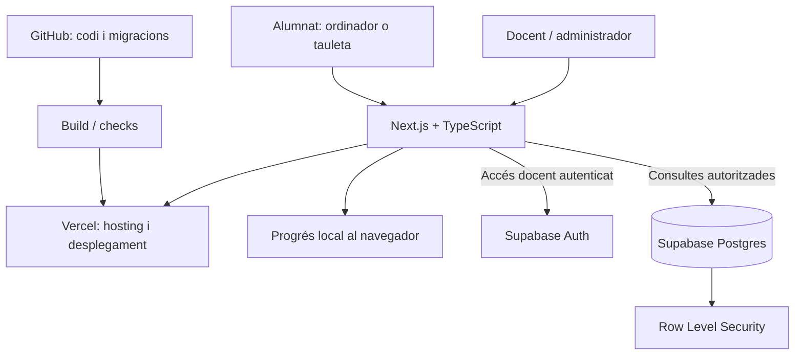

# QUI SOC DARRERE LA PANTALLA? — Arquitectura i decisions tècniques

## 1. Objectiu del producte

Experiència educativa interactiva en català per a 3r d'ESO, estructurada en cinc missions i 13 actuacions al llarg de 17 sessions. Temes: identitat digital, autoestima, comparació social, hàbits digitals, algoritmes, convivència i benestar. La web és el fil conductor; debats, treball cooperatiu i creació de la campanya final també tenen lloc fora de la web.

## 2. Arquitectura proposada

### Components

- **Next.js + TypeScript:** aplicació web, rutes, components i validació de tipus. Les operacions privilegiades s'executen al servidor.
- **Vercel:** hosting, desplegaments vinculats al repositori GitHub i entorns de preview.
- **Supabase Auth:** autenticació del personal docent i administradors.
- **Supabase Postgres:** aules, participants pseudònims, edicions del repte i, si es justifica, estat de progrés.
- **GitHub:** codi, revisió de canvis, documentació i migracions SQL versionades.
- **Progrés local:** primera opció per a l'alumnat, sense necessitat de crear comptes ni transmetre respostes personals.

Aquest document descriu una arquitectura proposada, no serveis ja desplegats ni connexions ja configurades.

## 3. Superfícies de l'aplicació

### Experiència de l'alumnat
- Portada i presentació de la plataforma fictícia MIRROR.
- Mapa de cinc missions, amb estat bloquejada/disponible/completada.
- Activitats interactives, pistes, reintents i retroacció.
- Recursos i opcions d'accessibilitat.
- Campanya final «Més enllà dels likes» i pantalla de tancament.

### Panell docent
- Gestió d'aules i participants amb àlies/codis pseudònims.
- Iniciar, pausar, tancar i reiniciar una edició del repte.
- Consultar progrés agregat per missió.
- En una fase posterior, gestionar publicació i ordre de continguts.

## 4. Model de dades inicial

- `profiles`: perfil de personal docent, rol i referència a `auth.users`.
- `classrooms`: aula/grup i estat.
- `participants`: identificador pseudònim dins d'una aula.
- `challenge_runs`: una edició concreta del repte, amb estat i dates.
- `missions` / `activities`: estructura i configuració no sensible.
- `progress`: participant pseudònim, activitat i estat (locked, available, in_progress, completed), amb marques temporals mínimes.
- `admin_audit_log`: actor, operació, àmbit i data per a accions administratives sensibles.

Es pot començar mantenint els continguts educatius versionats al repositori, sense taules editables per a missions fins que el professorat necessiti realment un CMS.

## 5. Seguretat i privacitat

1. Activar Row Level Security (RLS) en totes les taules exposades.
2. Separar les dades de cada aula i comprovar el rol docent al servidor.
3. No exposar mai la clau `service_role` al client.
4. Fer servir codis aleatoris revocables o àlies; no exigir noms legals ni correus de l'alumnat.
5. No emmagatzemar respostes dels qüestionaris emocionals ni crear perfils psicològics.
6. Les reflexions personals són voluntàries i no bloquegen missions.
7. No utilitzar rànquings ni comparacions públiques entre participants.
8. Definir una política de retenció i esborrament mínima, amb permisos per defecte restrictius.

### Reinici segur
El reinici ha de demanar confirmació i explicar-ne l'abast (participant o edició sencera). Cal registrar l'acció al log d'auditoria. Sempre que sigui possible, crear una nova edició del repte és més segur que esborrar registres anteriors.

## 6. Decisions d'arquitectura

| Decisió | Motiu |
|---|---|
| Next.js + TypeScript | Estructura clara de components i rutes, i validació de tipus. |
| Vercel | Desplegament integrat amb GitHub i previews per als canvis. |
| Supabase | Auth i Postgres en un únic servei, amb RLS. |
| Progrés local per començar | Redueix dades personals, dependències i feina abans del pilot. |
| Continguts al repositori al principi | Canvis revisables i versionats; evita construir un CMS prematurament. |
| Sense comptes d'alumnat a l'MVP | El document base no els considera necessaris. |
| Sense respostes emocionals al servidor | Protegeix la privacitat de menors i evita usos inadequats. |
| Sense IA, xat ni rànquings | No formen part dels requisits imprescindibles inicials. |

## 7. Fases

1. Prototip visual, navegació, mapa de missions, desbloqueig i progrés local.
2. Primera missió funcional, amb casos ficticis i classificació conceptual.
3. Simulador de likes i activitats sobre comparació, atenció i FOMO.
4. Simulador d'algoritmes, història ramificada, benestar i campanya final.
5. Panell docent i Supabase Auth/Postgres amb polítiques RLS.
6. Revisió de continguts, accessibilitat, seguretat i pilot amb alumnat.

## 8. Criteris tècnics d'acceptació

- Disseny usable en ordinadors i tauletes.
- Navegació per teclat i contrast llegible.
- Alternatives a arrossegar elements i a interaccions temporitzades.
- Reintents i retroacció sense competició.
- El desbloqueig comprova activitats digitals obligatòries; la reflexió personal és opcional.
- Progrés local recuperable al mateix dispositiu.
- Cap secret al bundle del navegador.
- Proves de RLS i autorització per rols abans de persistir dades de l'alumnat.
